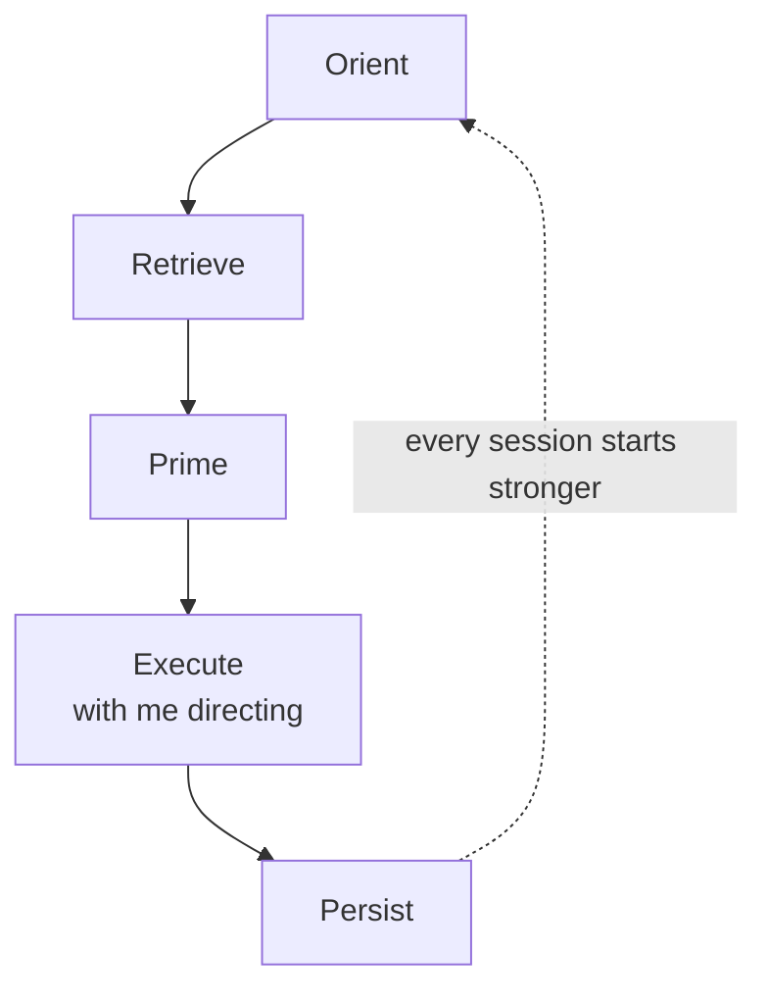

  

<h1 align="center">Cade</h1>

<strong>A persistent AI working partner built around structured memory, focused retrieval, and reusable Jobs.</strong>

  &nbsp;
  &nbsp;
  

In daily use · Designed and built by Davis Higgins

---

## See it in motion

  

Real capture of the public site's operating-loop chapter. <a href="assets/demo.png">Static frame</a>

## What it does

- **Remembers between sessions.** Projects, decisions, standards, and lessons persist, so work picks up where it left off instead of being re-explained.
- **Loads only what a task needs.** Cade pulls the smallest useful slice of context for the job in front of it, and everything else stays one search away.
- **Turns repeated work into Jobs.** Recurring work becomes a reusable Job that carries the procedure, the quality bar, and the lessons from every earlier attempt.

## Why I built it

I kept re-explaining the same projects, decisions, and standards to an assistant that forgot them the moment a chat ended. For anything ongoing, re-explaining cost more than the answer was worth.

The fix wasn't a better model. It was giving the model a durable place to keep what it learns and a disciplined way to read it back before it acts. Now analytics, builds, coursework, and career work continue instead of restarting.

## What I built

- The memory system and how it's organized
- The operating loop that governs when Cade reads, acts, and writes back
- The Job format, and the Jobs I use for analytics, development, and writing
- The public site at cade.davishiggins.com, designed to explain the system without exposing it

<strong>How it's put together</strong>

 

| Decision | Why |
|---|---|
| **Memory I own** | Cade's knowledge is readable and portable, so it's useful on its own and I can audit or correct anything by hand. |
| **Small context, on purpose** | Cade loads only what a task calls for, which keeps answers focused and leaves room for the work itself. |
| **I stay in control** | Consequential actions need my confirmation, outside content is treated as information rather than instructions, and access only grows when I grant it. |

## Screens

<table>
  <tr>
    <td width="62%"></td>
    <td rowspan="2" width="38%" align="center"></td>
  </tr>
  <tr>
    <td></td>
  </tr>
</table>

Homepage · The Jobs chapter · Homepage on mobile

## Technology

| Part | Technology |
|---|---|
| Assistant | Claude |
| Public site | Next.js, React, TypeScript |
| Motion | GSAP, Lenis, Three.js |
| Hosting | Vercel |

---

  &nbsp;
  

© 2026 Davis Higgins. All rights reserved. The Cade name and logo belong to Davis Higgins.

