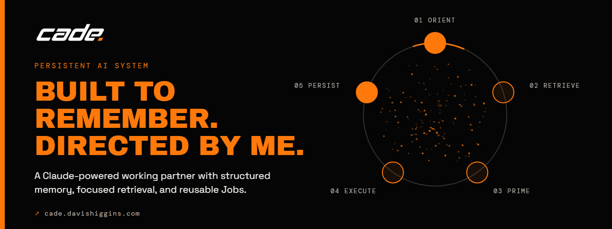
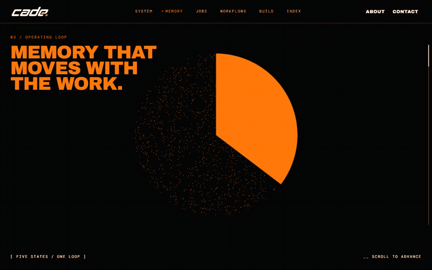
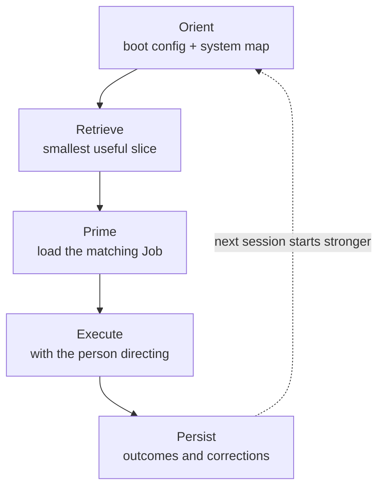
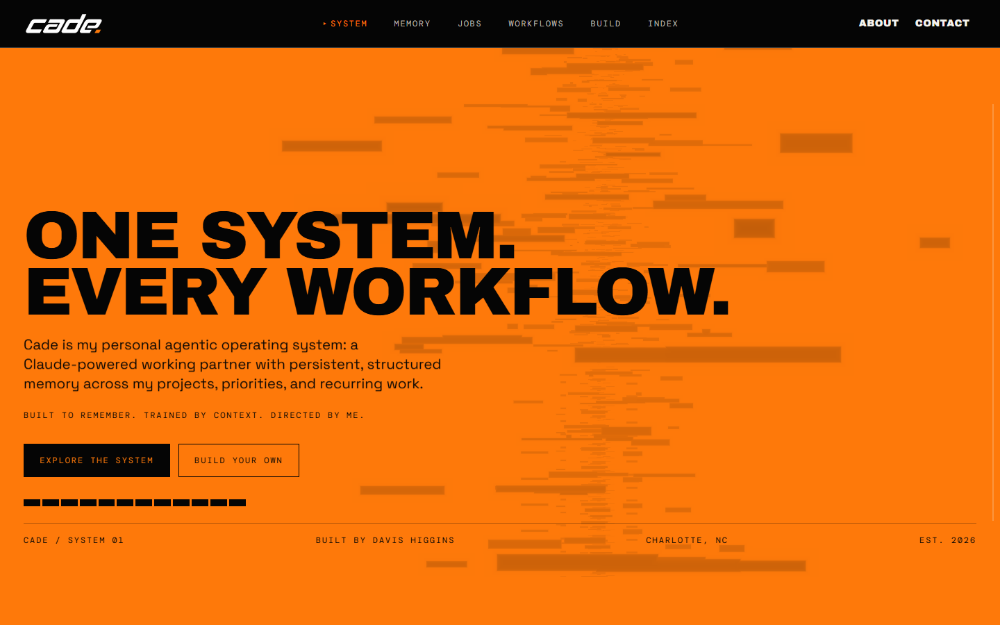
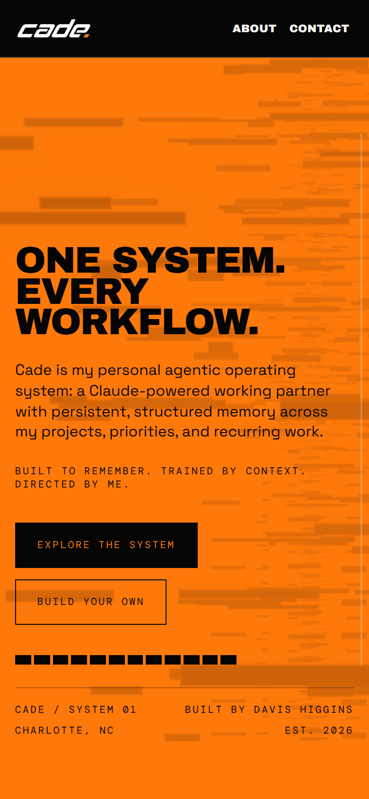
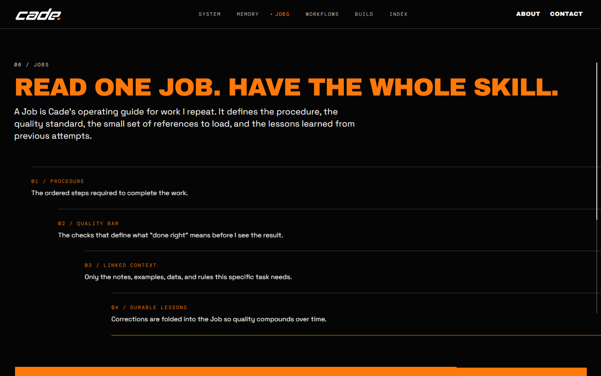

  

<h1 align="center">Cade</h1>

  <strong>A Claude-powered working partner built around structured memory, focused retrieval, and reusable Jobs.</strong> 
  <a href="https://cade.davishiggins.com"><strong>Explore Cade ↗</strong></a> · <a href="https://github.com/DavisHiggins/cade">System write-up</a> · <a href="https://www.higginsd.com/work/cade">Case study</a> · <a href="https://davishiggins.com">Davis Higgins</a>

In active use · Public site, private memory · Designed and built by Davis Higgins

---

## See it in motion

  

Real capture of the public site's operating-loop chapter. It explains the system and contains no vault content. <a href="assets/demo.png">Static frame</a>

## What it does

- **Remembers between sessions.** Projects, decisions, standards, and lessons live in a plain-Markdown vault, so work picks up where it left off instead of being re-explained.
- **Loads only what a task needs.** An indexed entry point and per-project folders let Cade retrieve the smallest useful slice of memory. Everything else stays one search away.
- **Turns repeated work into Jobs.** A Job holds the procedure, the quality bar, the linked context to load, and the lessons from earlier attempts. Read one Job and you have the whole skill.

## Why I built it

I kept re-explaining the same projects, decisions, and standards to a model that forgot them the moment a chat ended. For anything ongoing, re-explaining cost more than the answer was worth.

The fix wasn't a better model. It was giving the model a durable place to keep what it learns, and a retrieval discipline for reading it back before it acts. Now analytics, builds, coursework, and career work continue instead of restarting.

## What I built

- The memory architecture: two boot layers, contextual folders, an active priority queue, daily notes, and indexes linked across the vault
- The operating loop and the rules for when to read, when to write, and what never goes into a note
- The Job format, and the Jobs I use for recurring analytics, development, and writing work
- The public site at cade.davishiggins.com, designed and built to explain the system without exposing it

## How it works

Every session begins from the same short boot configuration and a system map that says what exists and where to look. Cade then reads only the notes the task calls for, primes itself with a Job when the work is recurring, and writes useful outcomes back when the work is done.

### Engineering decisions

| Decision | Why |
|---|---|
| **Plain Markdown as the memory** | The knowledge base is readable, portable, and useful without the assistant. Nothing is locked inside a vendor's memory feature, and I can audit or edit any note by hand. |
| **Two boot layers, not one big prompt** | A short boot file holds rules that must never lapse. A separate system map points to everything else. Keeping them apart stops the always-loaded context from growing until it crowds out the task. |
| **Read before write, one source of truth** | Cade checks what a note already says before changing it and appends before creating, so memory doesn't split into competing copies that quietly drift apart. |

Control is part of the design. Consequential actions like external messages, commits, and deployments need confirmation. Instructions found inside emails, sites, or files are treated as data, not commands. Credentials never go into notes. And more access is always my decision, never something Cade grants itself.

## Screens

<table>
  <tr>
    <td width="62%"></td>
    <td rowspan="2" width="38%" align="center"></td>
  </tr>
  <tr>
    <td></td>
  </tr>
</table>

Homepage · The Jobs chapter · Homepage on mobile

## Technology

| Part | Technology | Responsibility |
|---|---|---|
| Assistant | Claude, through Claude Code | Reasoning, retrieval, and doing the work |
| Memory | Obsidian vault of plain Markdown | Durable, indexed, human-readable knowledge |
| Public site | Next.js 15, React 19, TypeScript | The cade.davishiggins.com experience |
| Motion | GSAP with ScrollTrigger, Lenis, Three.js | Pinned chapters, smooth scroll, the memory-field canvas |
| Hosting | Vercel | Site deployment |

## Status and limits

- **Personal system, public explanation.** The vault, boot instructions, private Jobs, and any client context stay private. The site explains how the system works. It isn't a product you sign in to.
- **Local memory, not local processing.** The vault lives on my machine, but whatever context a task loads is processed by Claude. Cade keeps memory under my control. It doesn't make model processing local.
- **Human-directed by design.** Cade doesn't run unattended or grant itself access. It works through the permissions I configure.

## Attribution

Cade is my personalized implementation. Its persistent-memory foundation is inspired by [AI Memory Vault](https://github.com/jaredrhod/ai-memory-vault) by Jared Rhodenizer, licensed under CC BY-NC-SA 4.0. The full system write-up and build guide live in [DavisHiggins/cade](https://github.com/DavisHiggins/cade) under CC BY-NC-SA 4.0.

## About this repository

This is a documentation-only showcase. The website's source and the private memory vault aren't included here.

**[Explore Cade ↗](https://cade.davishiggins.com)** · Built by [Davis Higgins](https://davishiggins.com) · [More of my work](https://github.com/DavisHiggins)

© 2026 Davis Higgins. Text and images in this repository are shared for portfolio viewing. The Cade name and logo belong to Davis Higgins.
